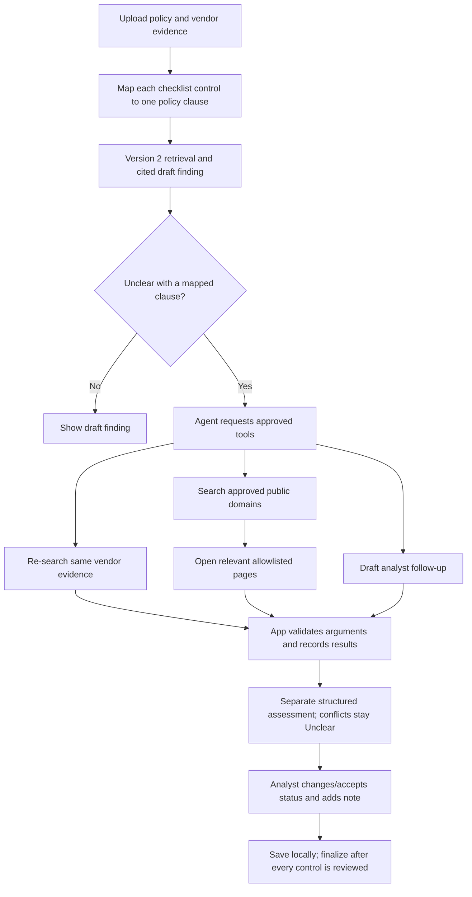

# AI Vendor Risk Assessor

## Configure AI findings

The assessment service uses the Groq API through its OpenAI-compatible endpoint.
Set the API key in the process environment or in a local `.env` file:

```env
GROQ_API_KEY=your_groq_api_key
GROQ_MODEL_ID=openai/gpt-oss-120b
GROQ_BASE_URL=https://api.groq.com/openai/v1
```

`GROQ_MODEL_ID` and `GROQ_BASE_URL` are optional; they default to
`openai/gpt-oss-120b` and `https://api.groq.com/openai/v1`. The older
`GROQ_MODEL` setting is still accepted if `GROQ_MODEL_ID` is unset. If your
`.env` contains a `replace_with_...` placeholder for either model setting,
remove it or replace it with a model supported by your Groq account. Keep
`.env` local and do not commit API keys.

Install dependencies and launch the app:

```powershell
pip install -r requirements.txt
python app.py
```

Upload company policies and vendor evidence, enter the vendor details, then run
the assessment. Findings use the versioned built-in checklist (`1.0.0`). Each
policy clause must be labeled with its control ID (for example, `SEC-01:` at
the start of a line). The finding uses that clause's uploaded wording and
retrieves vendor evidence against it. If a control ID is missing or occurs on
multiple clause headings, that finding is marked **Unclear** with a policy
mapping explanation; other controls continue. Untagged policy clauses are not
automatically mapped.

Findings are drafts for human review, not approval decisions. The app verifies
that reported citations match excerpts retrieved from the uploaded documents.
Relevant retrieved excerpts are sent to Groq for analysis; do not use this
integration with documents you are not permitted to share with that provider.

## Architecture flow



The model only requests tools. Python validates control IDs and executes them;
the vendor ID comes from the current assessment, never a model argument. There
is a hard cap of three tool calls per assessment investigation. Public research
uses Tavily only when both `TAVILY_API_KEY` and a non-empty
`APPROVED_PUBLIC_DOMAINS` exact-host allowlist are configured. The agent can
form a focused question, search those domains, open returned pages, and compare
the resulting public excerpts with uploaded evidence. The available call budget
may end before every useful page can be opened; unresolved or conflicting claims
remain **Unclear**. Search and page records retain title, URL, access date, and
excerpt. Public citations are labelled separately from uploaded evidence.

## Human review and local records

For each finding, select the control, accept or change its status, add an
analyst note, and save the finding review. A note is required when changing the
model's status. **Save draft** writes the current record under
`storage/reviews/`; **Finalize assessment** refuses to finalize until every
finding has an analyst review. Finalization records the reviewed statuses and
notes locally. This prototype does not deploy or send review decisions to an
external system.

## Offline evaluation

Run the deterministic contract evaluation with:

```powershell
\.venv\Scripts\python.exe -m unittest tests.test_v3_evaluation tests.test_assessor -v
```

The repository contains no vendor sample documents in `data/`, so this small
set uses synthetic access-review excerpts and a mocked model response. It checks
the application contract and citation/guardrail plumbing; it does not measure
Groq answer quality or validate live public search.

| Case | Expected | Actual | Citation/review check |
|---|---|---|---|
| Quarterly commitment supports policy | Met | Met | Supplied IDs resolve; analyst review required |
| Annual commitment falls short | Unmet | Unmet | Supplied IDs resolve; analyst review required |
| Uploaded evidence contains quarterly and annual claims | Unclear | Unclear | Citations resolve; follow-up requested |
| Vendor evidence missing | Unclear | Unclear | No vendor citation fabricated; follow-up requested |
| Public quarterly claim conflicts with uploaded annual claim | Unclear | Unclear | Public URL/date retained separately; follow-up requested |
| Model cites an unknown evidence ID | Rejected | Rejected | `CitationValidationError` |
| Vendor text contains prompt-injection instructions | Treat as untrusted | Prompt contract checked | Analyst remains final decision gate |
| Tool requests an unknown control ID | Reject tool request | Rejected | Search is not dispatched |

The model responses in this matrix are fixtures chosen to exercise expected
states. Before presenting this as an accuracy evaluation, run these cases with
the actual uploaded documents and configured Groq/public-search services, then
record the real outputs and analyst review decisions.

## Demo sequence

1. Configure Groq. For public research, also configure Tavily and the approved
   host allowlist.
2. Start the app locally with `python app.py` and upload one labelled policy
   document and vendor evidence.
3. Run the assessment. Show an ordinary cited finding and an unclear finding
   that triggers targeted investigation. With public search enabled, show a
   public page citation and its URL/access date.
4. Select a control in **Analyst review**, confirm or change its status, add a
   note for any status change, and save the review.
5. Save the draft, review all findings, and finalize. Show the local JSON record
   under `storage/reviews/`.

## Bounded agentic investigation (Version 3)

Each control first receives the Version 2 assessment. Only unclear findings with
a mapped policy requirement can trigger investigation. The model may request
three approved calls total: re-search uploaded evidence for a known control,
search configured public domains, or draft an analyst follow-up question. The
application derives the vendor ID and validates control IDs before dispatch;
follow-up questions are shown for review and are never sent to a vendor.

Public search is optional and uses Tavily. Set `TAVILY_API_KEY` and
`APPROVED_PUBLIC_DOMAINS` to a comma-separated allowlist of vendor trust/security
domains approved by your organization. Search results outside that exact host
allowlist are discarded. Public citations retain their title, URL, access date,
and excerpt and are labeled separately from uploaded vendor evidence. If no
connector is configured or the call limit is reached, unresolved findings stay
**Unclear**. A separate structured Groq assessment evaluates any collected
evidence; the analyst remains the final decision gate.
